# Biblioteca universitaria

[](https://spring.io/projects/spring-boot)
[](https://openjdk.org/)
[](https://github.com/eclipse-ee4j/mojarra)
[](https://hibernate.org/)
[](https://www.mysql.com/)
[](https://www.postgresql.org/)
[](https://biblioteca-rouge-eight.vercel.app/senati/login.xhtml)

Sigue siendo Spring Boot. El enlace de la aplicación es https://biblioteca-rouge-eight.vercel.app/senati/login.xhtml

## Problema que resuelve

La biblioteca prestaba en papel: no se sabía cuántos ejemplares quedaban, un alumno podía llevar más libros de la cuenta y la mora se calculaba a mano. Este sistema deja el catálogo, los usuarios y los préstamos en tres tablas, valida el ingreso contra el LDAP de la universidad y separa lo que ve el bibliotecario de lo que ve el estudiante.

## Lógica del sistema

Un usuario tiene muchos préstamos y un libro también. No hay tabla intermedia. La relación vive en `prestamos`, con `usuario_id` y `libro_id`.

`fechaEntrega` vacía significa que el libro sigue prestado. Si además `fechaDevolucion` ya pasó, esa fila es mora. El reporte y el PDF `usuarios-con-mora.pdf` salen de la misma consulta.

Antes de guardar, el sistema corta el préstamo en dos sitios: el validador de la pantalla y el servicio. Las dos reglas son las mismas.

- Un usuario no lleva un cuarto libro si ya tiene 3 con `fechaEntrega` vacía.
- El libro tiene que tener ejemplares disponibles. Los prestados no se restan de la columna `ejemplares`: se cuentan los préstamos abiertos.
- El ISBN tiene 13 dígitos. Si no, el libro no se guarda.
- El bibliotecario registra libros, usuarios, préstamos y devoluciones, y descarga los PDF.
- El estudiante ve el catálogo y solo sus préstamos. Si el LDAP acepta la clave pero `activo` es falso, la pantalla lo rechaza.

La búsqueda de libros usa caché de segundo nivel. `Prestamo` no se cachea, porque cambia en cada préstamo y cada devolución. El detalle está más abajo, con las capturas.

## Pantallas

El ingreso. El panel morado es la marca y el formulario queda a la derecha.

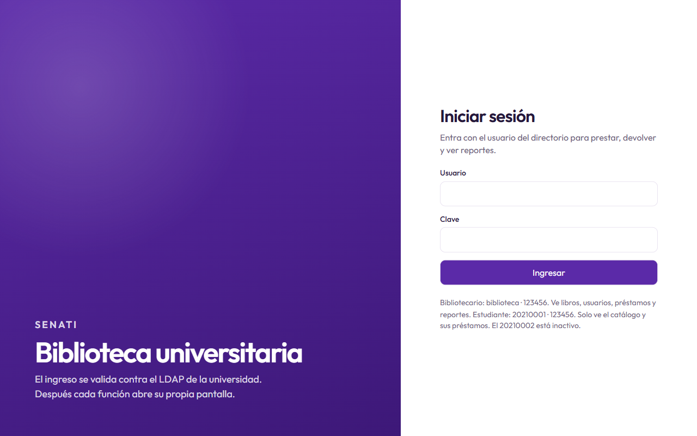

Inicio del bibliotecario. Cada tarjeta abre una sola función.

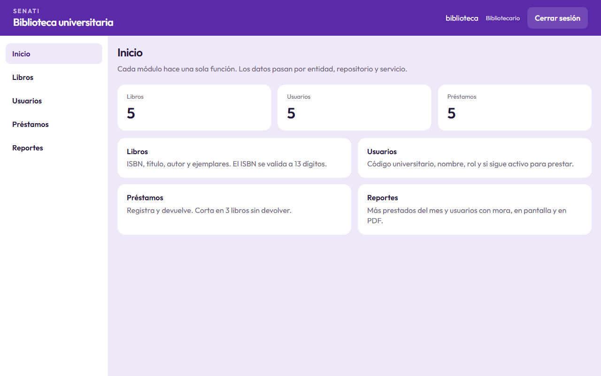

Catálogo. El ISBN se valida a 13 dígitos antes de guardar.

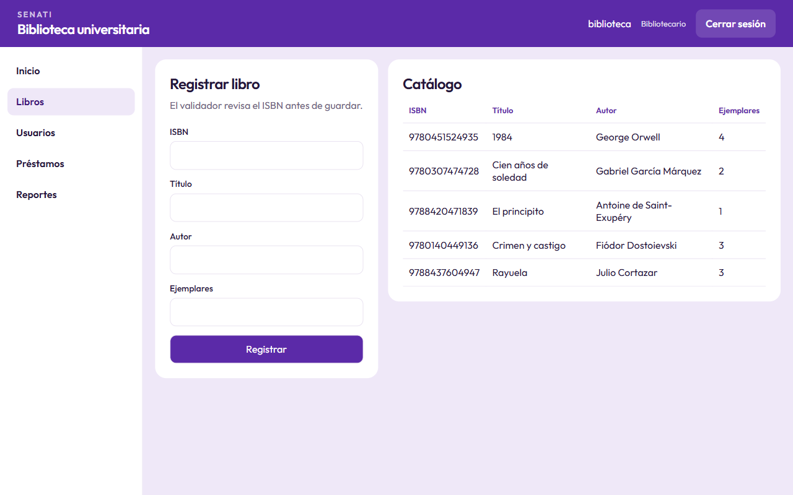

Usuarios. Aquí se marca si el estudiante sigue activo.

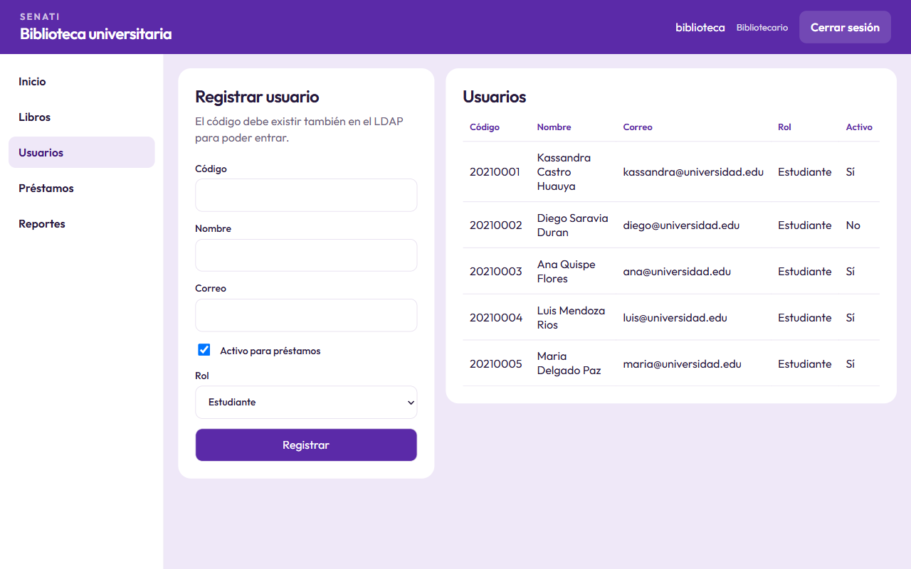

Préstamos. El alta corta en 3 libros sin devolver.

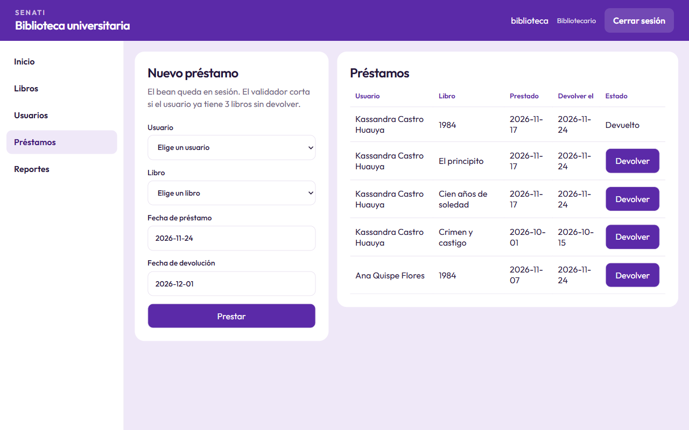

## Cómo sale el PDF

La pantalla de reportes y los dos PDF usan las mismas filas. No hay una consulta distinta para el archivo.

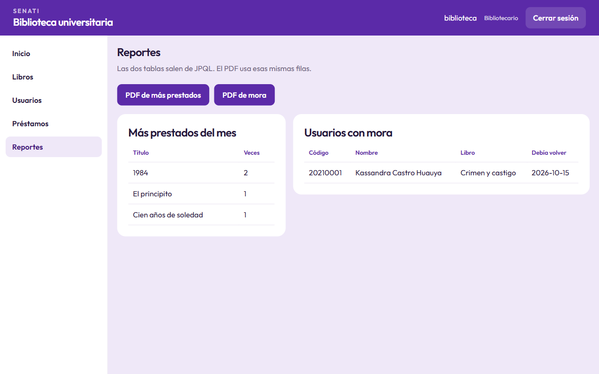

`PrestamoServiceImpl` pide el último mes y la mora de hoy. El controlador copia esas filas y `ReportePdf` las escribe. Los archivos se llaman `libros-mas-prestados.pdf` y `usuarios-con-mora.pdf`. Solo los abre el bibliotecario.

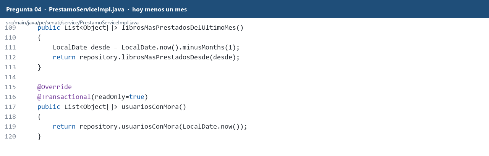

La JPQL de más prestados agrupa por libro desde una fecha. La de mora trae código, nombre, título y fecha pactada cuando `fechaEntrega` está vacía y `fechaDevolucion` ya pasó.

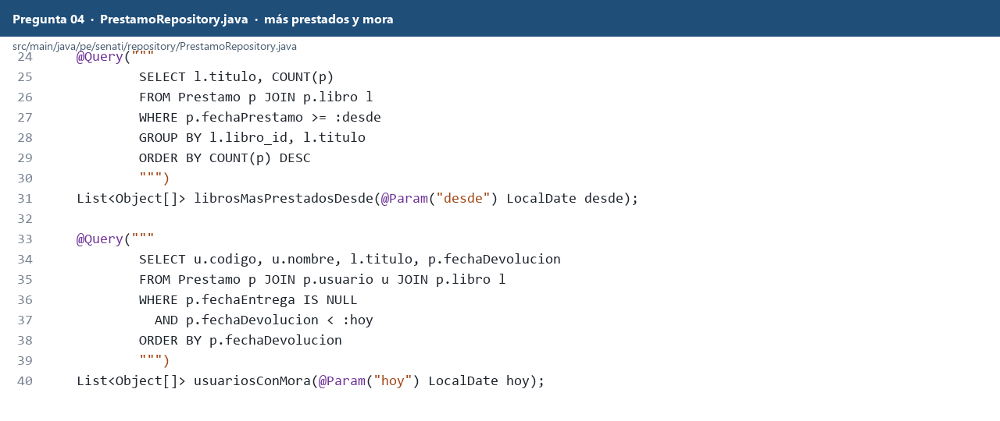

La disponibilidad de un libro también se consulta sin sesión:

```text
GET /senati/api/libros/1/disponibilidad
```

Responde el id, los ejemplares que quedan y si está disponible. No devuelve nombre ni código.

## Caché de segundo nivel

Solo `Libro` entra a la caché. La marca es `@Cacheable` y `@Cache` con `READ_WRITE`. `Prestamo` no lleva esas anotaciones.

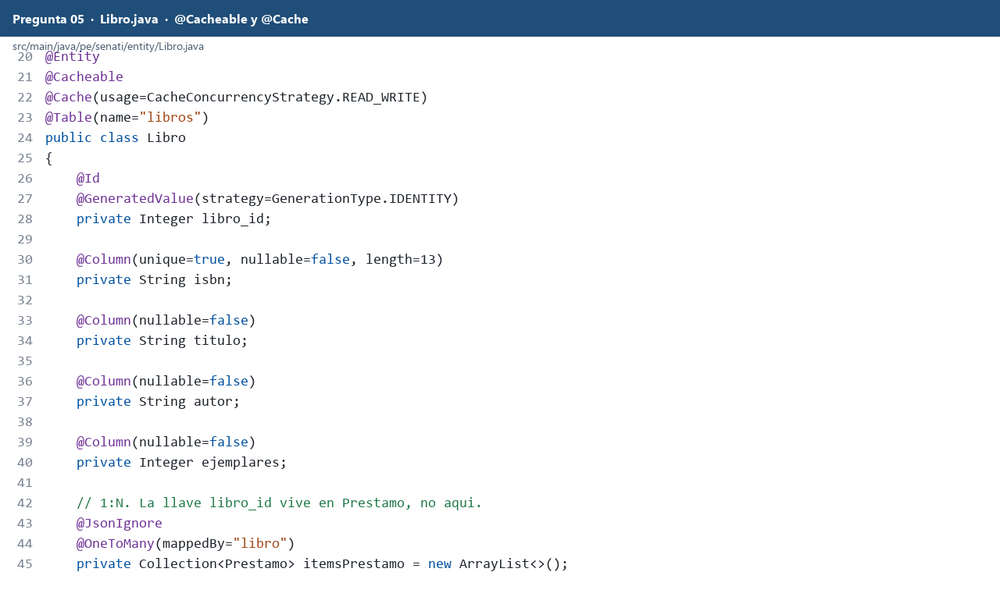

En `application.properties` se enciende la caché de segundo nivel y la de consultas. El proveedor es Ehcache. `ENABLE_SELECTIVE` hace que solo se cachee la entidad que lo pide.

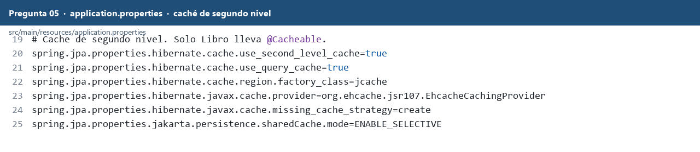

La búsqueda por título es la consulta que se guarda. El hint `org.hibernate.cacheable` en `true` le dice a Hibernate que puede reutilizar el resultado.

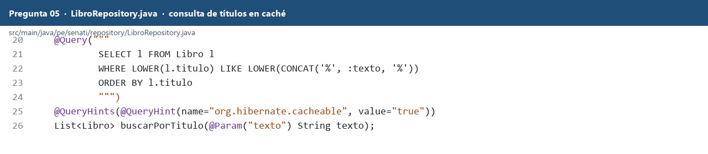

El `pom` trae `hibernate-jcache` y Ehcache 3 con el clasificador `jakarta`.

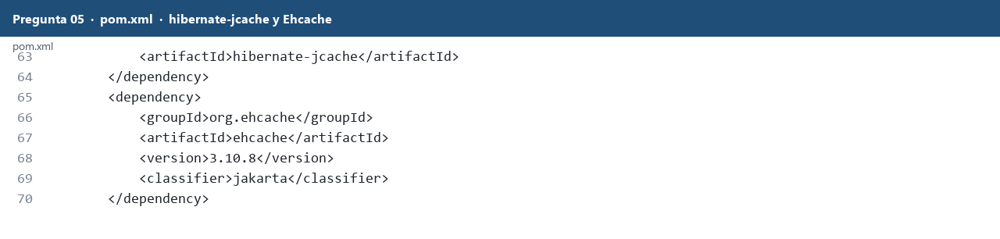

## Casos de uso

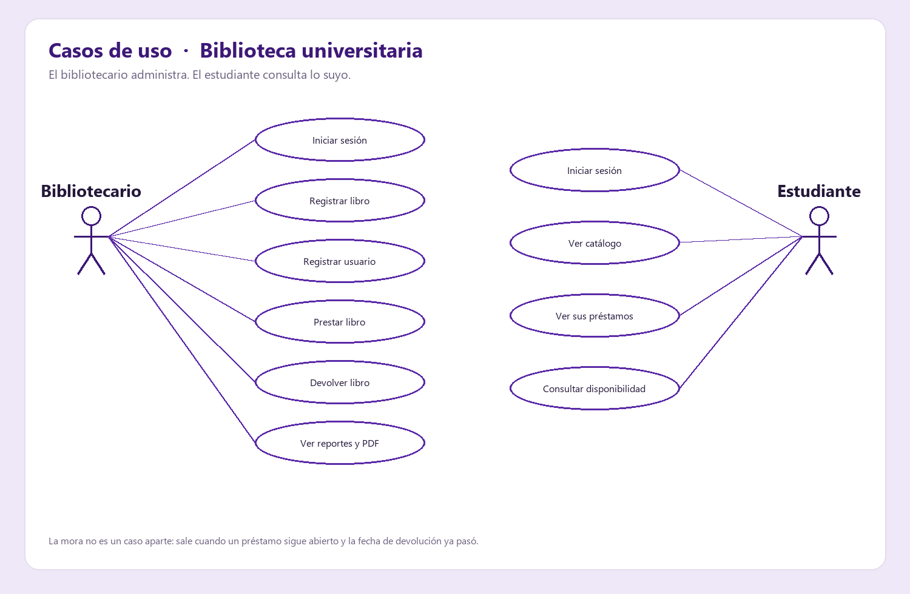

| Actor | Puede |
| --- | --- |
| Bibliotecario | Entrar, registrar libros y usuarios, prestar, devolver, ver reportes y bajar el PDF de mora |
| Estudiante | Entrar, ver el catálogo, ver sus préstamos y consultar la disponibilidad |

`Estudiante2` existe en el LDAP y está inactivo. Sirve para mostrar el rechazo.

## Entidades

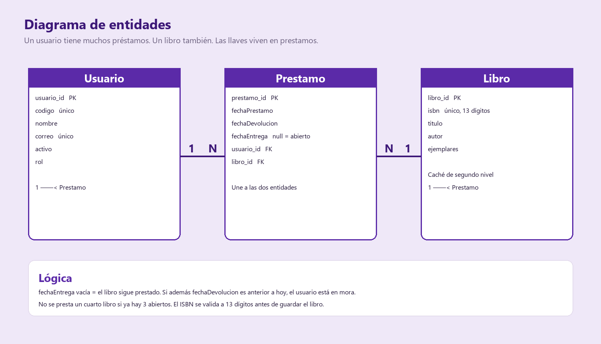

### Usuario

Tabla `usuarios`. Identifica a quien presta.

| Campo | Para qué |
| --- | --- |
| `usuario_id` | Clave generada |
| `codigo` | Único. Es el mismo usuario del LDAP: `Estudiante1`, `biblioteca` no se guarda aquí |
| `nombre` | Nombre que sale en las tablas y en el PDF |
| `correo` | Único |
| `activo` | Si es falso, no entra aunque el LDAP acepte la clave |
| `rol` | `BIBLIOTECARIO` o `ESTUDIANTE` |

### Libro

Tabla `libros`. Es el catálogo. Lleva `@Cacheable`.

| Campo | Para qué |
| --- | --- |
| `libro_id` | Clave generada |
| `isbn` | Único, 13 dígitos |
| `titulo` | Lo que se busca y se presta |
| `autor` | Autor del libro |
| `ejemplares` | Cuántos hay en total, no cuántos quedan en estante |

### Prestamo

Tabla `prestamos`. Une usuario y libro. Muchos préstamos apuntan a un usuario y muchos apuntan a un libro.

| Campo | Para qué |
| --- | --- |
| `prestamo_id` | Clave generada |
| `fechaPrestamo` | Día en que salió |
| `fechaDevolucion` | Día pactado. Si es anterior a hoy y no hay entrega, hay mora |
| `fechaEntrega` | Día real de la devolución. Vacía mientras sigue prestado |
| `usuario_id` | Llave hacia `usuarios` |
| `libro_id` | Llave hacia `libros` |

## Cómo probarlo

| Usuario | Clave | Qué ve |
| --- | --- | --- |
| `biblioteca` | `123456` | Libros, usuarios, préstamos y reportes |
| `Estudiante1` | `123456` | El catálogo y solo sus préstamos |
| `Estudiante2` | `123456` | El LDAP acepta la clave y la pantalla lo rechaza |

En la PC: JDK 21, MySQL y la base `db_biblioteca_web`.

```text
mvnw spring-boot:run
```

http://localhost:8096/senati/login.xhtml

La clave de la base no está en el repositorio ni en estas fotos. `MYSQL_PASSWORD` queda vacío si no se define, y el valor real vive en la PC o en las variables de Production de Vercel. No se publicaron el host de Render, el usuario de esa base ni su clave. `123456` es solo la clave de prueba del LDAP, la misma que se ve en el ingreso.
